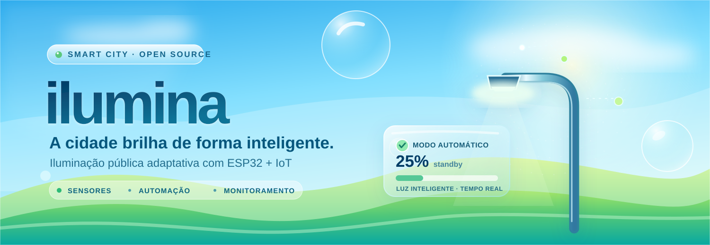
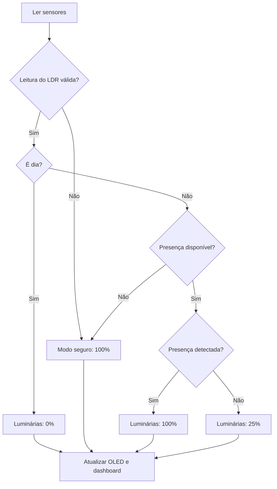
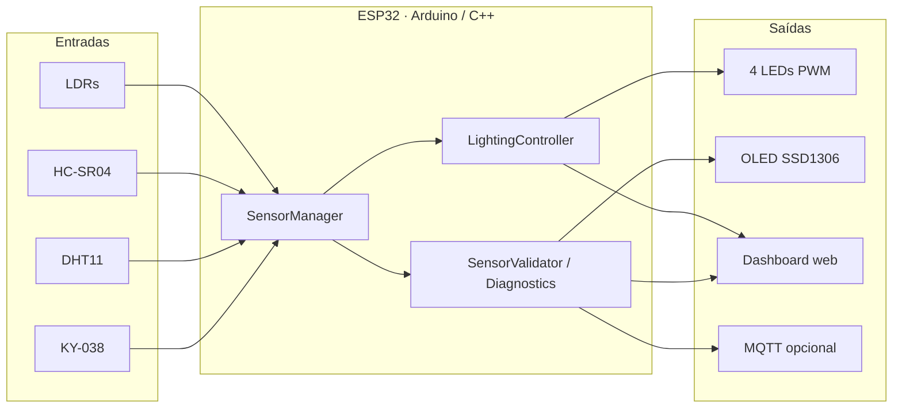
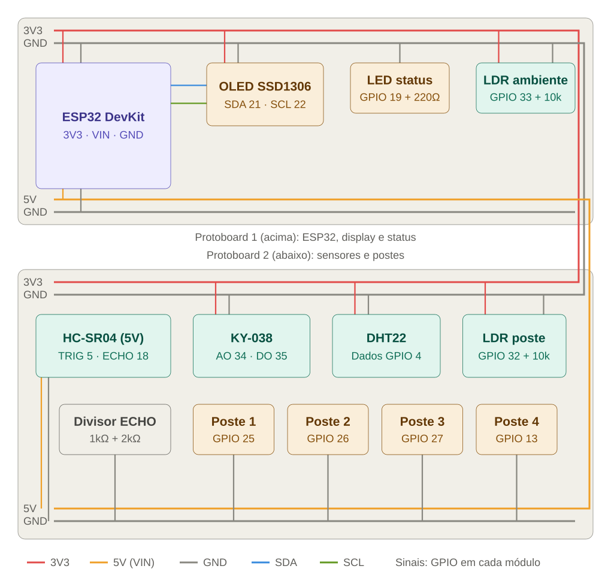

<div align="center">



<br>

**Uma cidade mais inteligente começa pela luz.**

Um protótipo de iluminação pública adaptativa com **ESP32, sensores, diagnóstico integrado e monitoramento em tempo real**.

[](https://www.espressif.com/)
[](https://platformio.org/)
[](https://www.arduino.cc/)


[Visão geral](#-visão-geral) · [Funcionamento](#-como-funciona) · [Instalação](#-começando) · [Dashboard](#-dashboard-web) · [Hardware](#-hardware-e-pinagem) · [Documentação](#-documentação)

</div>

---

## 🌿 Visão geral

O **Ilumina** é um projeto acadêmico de **gestão inteligente da iluminação pública com IoT**. Em vez de manter as luminárias na potência máxima o tempo todo, o sistema adapta sua intensidade à luminosidade ambiente e à presença de pessoas ou objetos.

Um **ESP32** lê os sensores, controla **quatro LEDs que simulam postes**, mostra informações no **display OLED SSD1306** e disponibiliza um **dashboard web servido diretamente pelo microcontrolador**. A telemetria por **MQTT** é opcional.

> [!IMPORTANT]
> **A iluminação funciona sem internet.** Wi-Fi e MQTT não são necessários para a lógica de controle: mesmo sem conexão com o roteador, o ESP32 continua operando os LEDs localmente.

### O que torna o Ilumina interessante?

- **Iluminação adaptativa** com PWM, transições suaves e histerese de luminosidade.
- **Monitoramento de sensores** com status de conexão, leituras e testes práticos.
- **Diagnóstico de inicialização** no OLED e no monitor serial.
- **Operação degradada segura** quando o LDR ou a detecção de presença não estão disponíveis.
- **Dashboard próprio** acessível pela rede Wi-Fi criada pelo ESP32.
- **Telemetria MQTT opcional** sem bloquear o controle local.

## ✨ Funcionalidades

| Recurso | O que faz |
| :--- | :--- |
| 💡 Iluminação inteligente | Ajusta os quatro LEDs de acordo com dia, noite e presença |
| 🌤️ LDR ambiente | Identifica transições de luminosidade com histerese |
| 🚶 HC-SR04 | Detecta presença na faixa configurada |
| 🌡️ DHT11 | Monitora temperatura e umidade |
| 🎙️ KY-038 | Acompanha variações relativas no nível sonoro, sem gravar áudio |
| 🧪 Testes de hardware | Diagnósticos no boot e testes sob demanda pelo painel |
| 📺 OLED SSD1306 | Exibe condições e estados do sistema localmente |
| 🫧 Dashboard web | Visualiza leituras, alertas, históricos e decisões de controle |
| 📡 MQTT | Publica telemetria, status e disponibilidade quando habilitado |

## ⚡ Como funciona

O firmware considera a luminosidade ambiente e, durante a noite, a presença nas proximidades das luminárias.

| Condição | Intensidade |
| :--- | ---: |
| ☀️ Dia | **0%** |
| 🌙 Noite sem presença | **25%** |
| 🚶 Noite com presença | **100%** |
| ⚠️ LDR ambiente indisponível | **100% — modo seguro** |
| ⚠️ Noite sem sensor de presença confirmado | **100% — modo seguro** |

Após a última presença, a intensidade elevada é mantida por **10 segundos**. Os limiares e tempos podem ser calibrados em [`include/AppConfig.h`](include/AppConfig.h).



### Arquitetura



## 🚀 Começando

### Requisitos

- Placa **ESP32 DevKit / NodeMCU-32S com ESP-WROOM-32**, 38 pinos, conforme o protótipo.
- Cabo USB de dados e computador com [PlatformIO](https://platformio.org/) instalado (CLI ou extensão do VS Code).
- Componentes da [tabela de hardware](#-hardware-e-pinagem), conforme a montagem desejada.

### 1. Clone o repositório

```bash
git clone https://github.com/MatheusMV05/ilumina.git
cd ilumina
```

### 2. Configure as credenciais (opcional)

O firmware compila e funciona localmente mesmo sem `include/secrets.h`. Para configurar rede, painel e MQTT, copie o modelo:

```bash
cp secrets.example.h include/secrets.h
```

Edite `include/secrets.h` com os dados da sua rede:

```cpp
#define WIFI_SSID "sua-rede"
#define WIFI_PASSWORD "sua-senha"

#define MQTT_ENABLED false
#define MQTT_HOST ""
#define MQTT_PORT 1883
#define MQTT_USERNAME ""
#define MQTT_PASSWORD ""

#define DEVICE_ID "poste-01"
#define DASHBOARD_ENABLED true
#define DASHBOARD_AP_SSID "Iluminacao-IoT"
#define DASHBOARD_AP_PASSWORD "sua-senha-segura"
```

> [!CAUTION]
> `include/secrets.h` é ignorado pelo Git. **Não publique senhas reais.** Altere a senha padrão do ponto de acesso antes de usar o painel perto de redes ou pessoas não confiáveis.

### 3. Compile e envie ao ESP32

```bash
pio run
pio run -t upload
pio device monitor
```

O monitor serial usa **115200 baud**. O arquivo [`platformio.ini`](platformio.ini) contém portas de upload/monitor configuradas com um padrão macOS (`/dev/cu.usbserial-*`); em Windows ou Linux, ajuste esses valores para a porta detectada ou remova-os para seleção automática.

As dependências, incluindo **Adafruit SSD1306**, **Adafruit GFX**, **DHT sensor library**, **Adafruit Unified Sensor** e **PubSubClient**, são gerenciadas pelo PlatformIO.

## 🫧 Dashboard web

O ESP32 cria um ponto de acesso Wi-Fi próprio, permitindo visualizar o painel **mesmo sem roteador**.

1. Conecte o celular ou notebook à rede **`Iluminacao-IoT`**.
2. Use a senha definida em `DASHBOARD_AP_PASSWORD` (sem arquivo de configuração, o valor padrão do firmware é `iluminacao123`).
3. Abra **http://192.168.4.1** no navegador.

Quando o ESP32 também estiver conectado a um roteador, o painel pode ser aberto pelo endereço IP informado no monitor serial.

O dashboard reúne resumo do estado do sistema, explicação da decisão de iluminação, cartões de sensores, minigráficos, histórico de luminosidade e brilho, além de testes práticos.

**Quer conhecer a interface sem montar o circuito?** Rode o protótipo em [`web-prototipo/`](web-prototipo/), a mesma interface com **dados simulados**:

```bash
cd web-prototipo
npm install
npm run dev
```

O painel real em `web/` também aceita `?demo` na URL (`npm run dev` e abra `http://localhost:5173/?demo`).

### API local

| Método | Endpoint | Finalidade |
| :--- | :--- | :--- |
| `GET` | `/api/state` | Consultar o estado do sistema em JSON |
| `POST` | `/api/test?c=LDR_AMBIENT` | Iniciar um teste prático do componente |
| `POST` | `/api/confirm?c=LEDS` | Registrar confirmação visual do usuário |

Essas rotas não fazem acionamento remoto direto das luminárias.

### Editar a interface

O painel é um app **React + TypeScript** (Vite) em `web/`. O build gera um único HTML com JS e CSS embutidos, comprimido com gzip em `include/DashboardPage.h`. O ESP32 envia esse arquivo com `Content-Encoding: gzip` e não precisa de internet.

```bash
cd web
npm install          # uma vez
npm run dev          # abra http://localhost:5173/?demo (dados simulados)
VITE_POSTE=http://192.168.4.1 npm run dev   # dados reais do poste, com hot reload
npm run build        # checa os tipos e regera include/DashboardPage.h
```

Depois do `npm run build`, grave o firmware de novo (`pio run -t upload`). Não edite o cabeçalho gerado manualmente.

## 🔌 Hardware e pinagem

O protótipo utiliza uma placa **ESP32 de 38 pinos**. Confira os nomes impressos nos terminais da placa: a disposição dos pinos varia entre modelos.

| Componente | Conexões no ESP32 | Observação |
| :--- | :--- | :--- |
| OLED SSD1306 | SDA: **GPIO 21** · SCL: **GPIO 22** | I²C, 3,3 V |
| HC-SR04 | TRIG: **GPIO 5** · ECHO: **GPIO 18** | Alimentação 5 V; ECHO exige divisor resistivo |
| DHT11 | DATA: **GPIO 4** | Alimentação 3,3 V |
| KY-038 | AO: **GPIO 34** · DO: **GPIO 35** | Alimentação 3,3 V; GPIOs só de entrada |
| LDR ambiente | **GPIO 33** | Divisor com resistor de 10 kΩ |
| LDR do poste | **GPIO 32** | Divisor com resistor de 10 kΩ; monitora o LED 1 |
| Quatro LEDs | **GPIO 25, 26, 27, 13** | Um resistor de 220 Ω por LED |
| LED de status | **GPIO 19** | Resistor de 220 Ω |

**Sensores opcionais não instalados na montagem atual:** IR e MQ-135. Estão desabilitados por padrão em `AppConfig.h` e exigem conexão e configuração antes de serem habilitados.

<div align="center">

<br>
<sub>Esquema de ligação do hardware.</sub>
</div>

### Segurança elétrica

> [!WARNING]
> - **Nunca conecte o ECHO de 5 V do HC-SR04 diretamente ao ESP32.** Use o divisor de tensão de **1 kΩ + 2 kΩ** descrito na documentação.
> - Compartilhe o **GND** entre todos os componentes.
> - Não aplique 5 V externos ao pino **3V3**.
> - Os LEDs representam luminárias em uma **maquete**. O projeto não implementa acionamento direto de rede elétrica ou de postes reais.

Detalhes de montagem e diagnósticos estão em [`gestao_inteligente_iluminacao_publica_iot.md`](gestao_inteligente_iluminacao_publica_iot.md), [`include/PinMap.h`](include/PinMap.h) e [`chat-esquema-esp32.md`](chat-esquema-esp32.md).

## 📡 Telemetria MQTT

Com MQTT habilitado e broker configurado, o ESP32 publica:

| Tópico | Conteúdo | Frequência |
| :--- | :--- | :--- |
| `public-lighting/{DEVICE_ID}/telemetry` | Leituras e estado operacional | A cada **15 s** |
| `public-lighting/{DEVICE_ID}/status` | Saúde dos componentes | A cada **60 s** e na conexão |
| `public-lighting/{DEVICE_ID}/availability` | `online` / `offline` | Estado retido e Last Will |

A conectividade é gerenciada separadamente da lógica principal; quedas de Wi-Fi ou do broker não impedem o controle local da iluminação.

## 🩺 Diagnóstico e validação

Ao ligar, o firmware executa uma sequência de verificações e exibe estados no OLED e no serial. Os testes incluem:

- Verificação visual dos LEDs e análise do LDR próximo ao primeiro poste.
- Leitura e plausibilidade dos LDRs, DHT11 e KY-038.
- Resposta do sensor ultrassônico com solicitação de aproximação de objeto.
- Identificação do OLED pela conexão I²C.
- Estado da conectividade Wi-Fi/MQTT.

Os testes práticos solicitados ao operador têm tempo limite e não devem travar a inicialização.

**Roteiro recomendado:** simule dia e noite cobrindo/iluminando o LDR; aproxime um objeto do HC-SR04 durante a noite; desconecte um sensor e observe o modo seguro; desligue o Wi-Fi para confirmar a autonomia local.

## 📁 Estrutura do projeto

```text
ilumina/
├── .github/
│   └── assets/
│       └── ilumina-frutiger-aero.svg
├── include/
│   ├── AppConfig.h           # Parâmetros e calibração
│   ├── PinMap.h              # GPIOs dos componentes
│   ├── SensorManager.h       # Leituras
│   ├── SensorValidator.h     # Validação e testes
│   ├── Diagnostics.h         # Saúde dos componentes
│   ├── LightingController.h  # Controle adaptativo
│   ├── DisplayManager.h      # Interface OLED
│   ├── ConnectivityManager.h # Rede e MQTT
│   ├── DashboardServer.h     # Servidor HTTP
│   ├── DashboardPage.h       # HTML embarcado (gerado)
│   └── Telemetry.h           # Estados em JSON
├── src/                      # Implementações C++ e main.cpp
├── web/                      # Painel web (React + TypeScript)
│   ├── src/                  # Componentes, tipos e simulação
│   └── scripts/embed.mjs     # Gera include/DashboardPage.h
├── web-prototipo/            # Mesmo painel, só com dados simulados
├── test/
├── platformio.ini
├── secrets.example.h
├── esquema-ligacao.svg
└── gestao_inteligente_iluminacao_publica_iot.md
```

## 📚 Documentação

| Arquivo | Conteúdo |
| :--- | :--- |
| [Documentação técnica completa](gestao_inteligente_iluminacao_publica_iot.md) | Planejamento, montagem e especificações do protótipo |
| [Mapa de pinos](include/PinMap.h) | GPIOs efetivamente usados no firmware |
| [Configuração](include/AppConfig.h) | Limiares, tempos, opções e parâmetros |
| [Esquema elétrico](esquema-ligacao.svg) | Diagrama da ligação |
| [Painel web](web/src/App.tsx) | Código-fonte do dashboard |
| [Protótipo](web-prototipo/) | Painel com dados simulados, sem ESP32 |
| [Credenciais de exemplo](secrets.example.h) | Modelo de configuração local |

## 🌍 Impacto e limitações

O projeto está alinhado com o debate sobre **energia limpa, cidades sustentáveis e eficiência de recursos** (ODS 7, 11 e 13). A proposta acadêmica estabelece metas de redução de consumo e melhoria na manutenção, **mas esses resultados ainda não são métricas comprovadas pelo protótipo**.

A demonstração utiliza LEDs de baixa potência, não luminárias públicas reais. Os LDRs produzem valores ADC, e o KY-038 mede níveis **relativos** de som, não decibéis SPL calibrados. A verificação de alguns LEDs depende de confirmação visual; não há medição elétrica individual de todas as saídas.

---

<div align="center">

**ilumina** · *Tecnologia para cidades mais conscientes.*

<sub>Protótipo acadêmico de iluminação pública inteligente com ESP32 e IoT.</sub>

</div>
