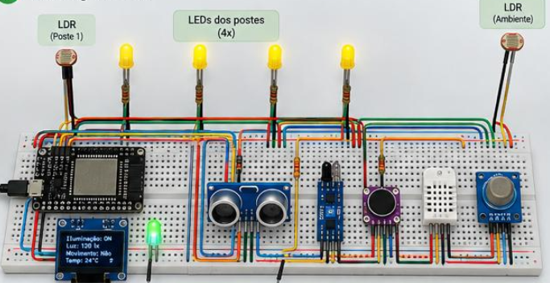
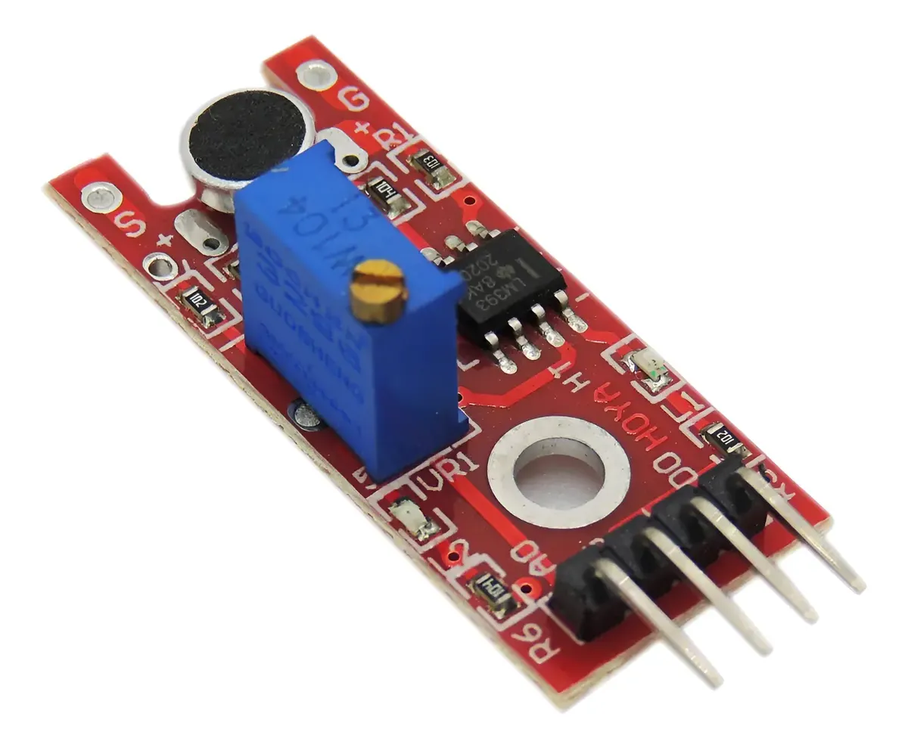
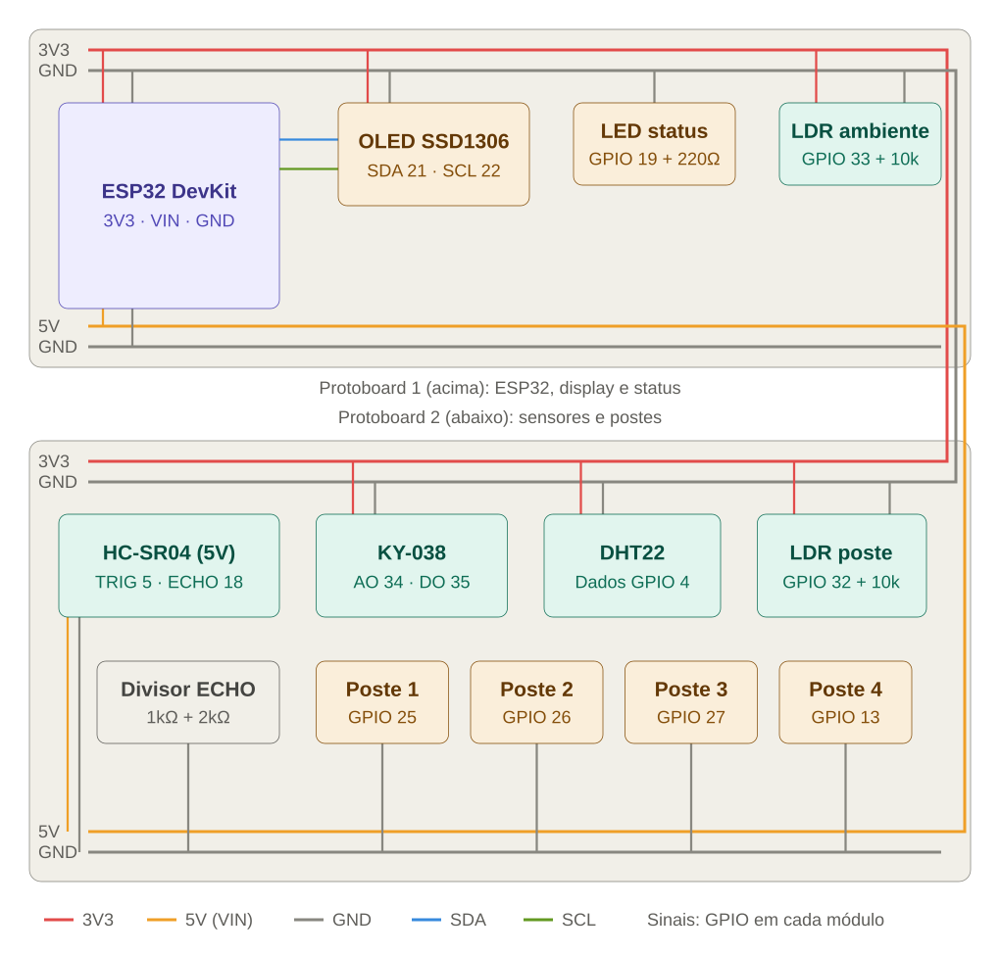

# Esquema de ligação — ESP32 em duas protoboards

Registro da conversa sobre a montagem do projeto com ESP32, sensores e LEDs dos postes.

---

## Pergunta

> Desenvolva uma imagem nos ajudando com a conexão dos componentes.
>
> Sensor De Som Ky-038 Microfone, este é o nosso microfone. Temos o mesmo sensor ultrassônico, o mesmo display OLED, o mesmo ldr, o sensor de temperatura e umidade também que estão na imagem.
>
> Quero também um esquema como tinkercad com as conexões e como vamos organizar. Temos duas protoboards.

**Imagem 1 — montagem de referência**

**Imagem 2 — sensor de som KY-038**

---

## Resposta

Aqui vai a proposta de montagem. A ideia é dividir em protoboard 1 (controle: ESP32, display, LED de status e LDR ambiente) e protoboard 2 (sensores e postes), ligando os trilhos de alimentação entre elas com jumpers.

Para montar, este é o mapa completo de pinos:

| Componente | Pino do módulo | Liga em | Observação |
|---|---|---|---|
| OLED SSD1306 | VCC / GND / SDA / SCL | 3V3 / GND / GPIO 21 / GPIO 22 | I2C padrão do ESP32 |
| HC-SR04 | VCC / GND / TRIG / ECHO | 5V (VIN) / GND / GPIO 5 / GPIO 18 | ECHO passa pelo divisor |
| KY-038 | + / G / AO / DO | 3V3 / GND / GPIO 34 / GPIO 35 | 34 e 35 são só entrada, perfeito aqui |
| DHT22 (ou DHT11) | VCC / GND / DATA | 3V3 / GND / GPIO 4 | Pull-up de 10k se o sensor for "nu" |
| LDR ambiente | uma perna / outra perna | 3V3 / GPIO 33 + 10k até GND | Divisor de tensão |
| LDR poste | uma perna / outra perna | 3V3 / GPIO 32 + 10k até GND | Divisor de tensão |
| LEDs dos postes | ânodo (perna longa) | GPIO 25, 26, 27, 13 via 220Ω | Cátodo no GND |
| LED de status | ânodo | GPIO 19 via 220Ω | Cátodo no GND |

Alguns pontos merecem atenção, porque são onde esse tipo de montagem costuma dar problema.

O HC-SR04 precisa de 5V para funcionar bem, mas o pino ECHO devolve 5V, e o ESP32 só aguenta 3,3V. Por isso o divisor: ECHO → resistor de 1kΩ → GPIO 18, e do GPIO 18 um resistor de 2kΩ até o GND. Se não tiver 2kΩ, dois de 1kΩ em série resolvem.

Todos os sensores analógicos (LDRs e o AO do KY-038) estão nos GPIOs 32 a 35, que são do ADC1. Isso é proposital: o ADC2 para de funcionar quando o Wi-Fi está ligado, então se vocês forem usar MQTT, nada analógico pode ficar nos pinos do ADC2 (como 25, 26, 27, 13, que ficaram para os LEDs).

Alimente o KY-038 com 3V3, não 5V. Com 5V a saída analógica pode passar de 3,3V e danificar a entrada. O potenciômetro azul dele ajusta o limiar do DO; para ler intensidade de som use o AO.

Sobre as protoboards: o ESP32 DevKit é largo e costuma ocupar quase toda a largura de uma protoboard, deixando só uma fileira livre de cada lado, por isso ele fica sozinho com o display na protoboard 1. Deixem o trilho de cima como 3V3 e o de baixo como 5V em ambas, e liguem os GND das duas placas entre si, senão as leituras ficam erradas. Vale marcar os trilhos com fita para ninguém ligar um sensor de 3,3V no 5V por engano.

Por fim, deixei de fora o sensor infravermelho e o sensor de gás que aparecem na imagem original, já que vocês só citaram os outros componentes. Se forem usá-los, me diz que eu encaixo os pinos.
